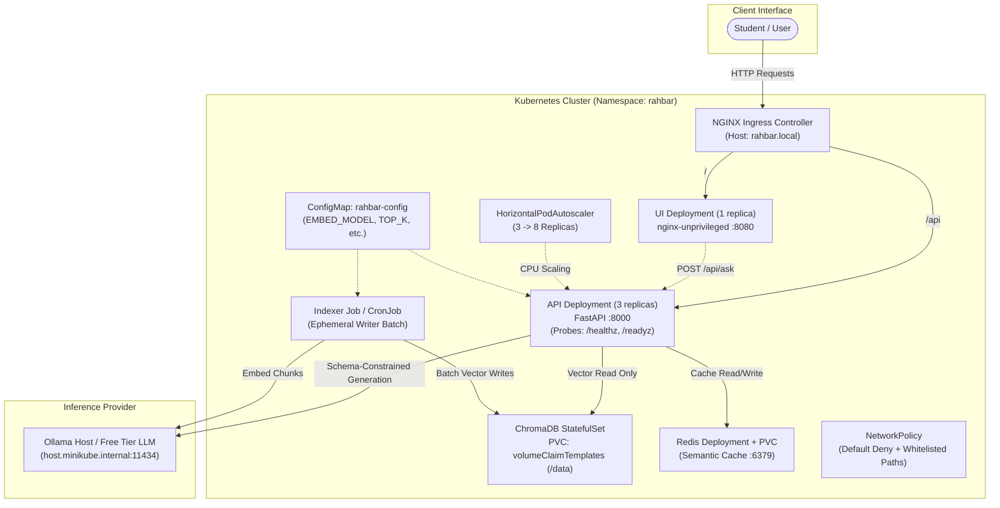

# RAHBAR: Grounded RAG on Kubernetes

[](https://github.com/hassanahsan843-pixel/rahber_starter/actions/workflows/ci.yml)
[](https://github.com/hassanahsan843-pixel/rahber_starter/actions/workflows/cd.yml)
[](LICENSE)
[](https://kubernetes.io/)

RAHBAR is an enterprise-grade, grounded question-answering service deployed on Kubernetes. It operates over official academic policy documents, strictly citing its sources, eliminating hallucinations through deterministic schema constraints, and abstaining when information is absent from its corpus.

Built as part of CS4032: Software Construction & Development (SCD).

---

## Architecture Overview

RAHBAR decouples the **write path** (corpus indexing) completely from the **read path** (real-time query answering):
- **The Indexer** runs as an isolated Kubernetes `Job` or scheduled `CronJob`, processing raw documents through a 5-stage pipeline and writing vector embeddings with strict metadata into ChromaDB.
- **The API Service** runs as a high-availability, 3-replica Deployment with read-only access to ChromaDB, sub-second Redis semantic caching, and strict Pydantic output validation.



---

## API Specification

The API service exposes the following endpoints:

| Method | Path | Purpose | Probing & Security |
| :--- | :--- | :--- | :--- |
| GET | `/healthz` | **Liveness Probe**: Confirms the FastAPI process is alive. Does not touch dependencies. | Kubelet restart probe |
| GET | `/api/healthz` | API health route used by the Ingress smoke test. | Deployment smoke test |
| GET | `/readyz` | **Readiness Probe**: Returns `200` only if Chroma is reachable, the collection is non-empty, Redis is responsive, and `EMBED_MODEL` matches metadata. Otherwise returns `503`. | Traffic routing probe |
| GET | `/metrics` | **Prometheus Metrics**: Exposes latency histograms, token counters, cache hit ratios, and abstentions. | Prometheus scrape |
| POST | `/api/ask` | **Query Endpoint**: Accepts `{"question": "..."}` and returns a validated `AskResponse` with citations. | User traffic |

### Sample Question Payload
```bash
curl -X POST "http://rahbar.local/api/ask" \
  -H "Content-Type: application/json" \
  -d '{"question": "What is the minimum CGPA required to avoid academic warning?"}'
```

---

## Local Cluster Quickstart (Minikube)

Follow these steps from a clean clone to deploy against the verified FAST-NUCES corpus. The `dev` overlay is for the tiny synthetic CI fixture corpus; it is not the real university corpus.

### 1. Prerequisites
- Docker Engine & Minikube
- `kubectl` & `kustomize`
- A Groq API key for hosted answer generation, and Ollama running locally for embeddings:
  ```bash
  export OLLAMA_HOST=0.0.0.0
  ollama serve
  ollama pull nomic-embed-text
  ```

### 2. Start Minikube with Calico CNI
Calico is required to enforce Kubernetes `NetworkPolicy` objects:
```bash
minikube start --driver=docker --cni=calico --memory=6144 --cpus=4
minikube addons enable metrics-server
minikube addons enable ingress
```

### 3. Build & Load Container Images
```bash
docker build -t rahbar-api:dev api
docker build -t rahbar-indexer:dev indexer
docker build -t rahbar-ui:dev ui

minikube image load rahbar-api:dev
minikube image load rahbar-indexer:dev
minikube image load rahbar-ui:dev
```

### 4. Download and verify the public corpus

The PDFs are not committed. Download them locally, verify their checksums, then stage them into the production overlay's PVC:

```bash
python -m pip install httpx pyyaml
python corpus/fetch.py
python corpus/fetch.py --verify

kubectl apply -f k8s/base/namespace.yaml
kubectl apply -f k8s/overlays/prod/corpus-pvc.yaml
kubectl apply -f scripts/corpus-loader-pod.yaml
kubectl wait --for=condition=Ready pod/rahbar-corpus-loader -n rahbar --timeout=120s
kubectl cp corpus/raw/. rahbar/rahbar-corpus-loader:/corpus
kubectl delete pod rahbar-corpus-loader -n rahbar --wait=true
```

The corpus is stored on a PVC because Kubernetes ConfigMaps cannot hold this document set. The Indexer Job and weekly CronJob mount that PVC read-only.

### 5. Create the runtime Secret and apply manifests

Set `LLM_API_KEY` to your hosted provider key and `CACHE_INVALIDATION_TOKEN` to a private random value in your shell. Then apply the production overlay:

```bash
export CACHE_INVALIDATION_TOKEN="$(openssl rand -hex 32)"
# Create runtime Secret from shell variables (NEVER commit real keys)
kubectl create secret generic rahbar-secret -n rahbar \
  --from-literal=LLM_API_KEY="$LLM_API_KEY" \
  --from-literal=CACHE_INVALIDATION_TOKEN="$CACHE_INVALIDATION_TOKEN" \
  --dry-run=client -o yaml | kubectl apply -f -

# Apply production manifests: the Indexer Job runs once against the staged corpus.
kubectl apply -k k8s/overlays/prod

# Wait for stateful services and the real index build.
kubectl wait --for=condition=ready pod -l app=chroma -n rahbar --timeout=120s
kubectl wait --for=condition=ready pod -l app=redis -n rahbar --timeout=120s
kubectl wait --for=condition=complete job/rahbar-indexer -n rahbar --timeout=900s
```

### 6. Run the Indexer Job again when documents change

The initial apply creates the `rahbar-indexer` Job. For later re-indexing, first stage the updated files into the PVC with the loader pod above, then run:
```bash
kubectl create job --from=cronjob/reindex manual-indexer-1 -n rahbar
kubectl wait --for=condition=complete job/manual-indexer-1 -n rahbar --timeout=900s
```

### 7. Verify Rollout & Scaling
```bash
# Ensure API deployment has rolled out successfully across all 3 replicas
kubectl rollout status deployment/rahbar-api -n rahbar --timeout=180s

# Verify active endpoints
kubectl get endpoints -n rahbar

# Verify HPA metrics
kubectl get hpa -n rahbar
```

---

## Grounded RAG Pipeline

1. **Extraction**: `pdfplumber` and `pypdf` extract clean text, while `pytesseract` handles scanned image PDFs.
2. **Cleaning**: Normalizes whitespace and artifacts while strictly retaining numbered clause hierarchies.
3. **Chunking**: Structure-aware chunking with token overlap. Measures storage amplification.
4. **Embedding**: Pinned to `nomic-embed-text`. Mismatches halt API startup via readiness guardrails.
5. **Retrieval**: ChromaDB cosine similarity with `superseded: false` metadata filters.
6. **Generation**: Low temperature (`0.2`) with schema enforcement using Pydantic `Answer` models.
7. **Honest Abstention**: When chunks do not clear the relevance floor, returns `answered_from_context: false`.
8. **Semantic Cache**: Redis cosine similarity lookup for fast instant answers, invalidated upon re-index.

---

## License & Attribution
Licensed under the MIT License. See [docs/AI-USAGE.md](docs/AI-USAGE.md) for transparent AI disclosure.
